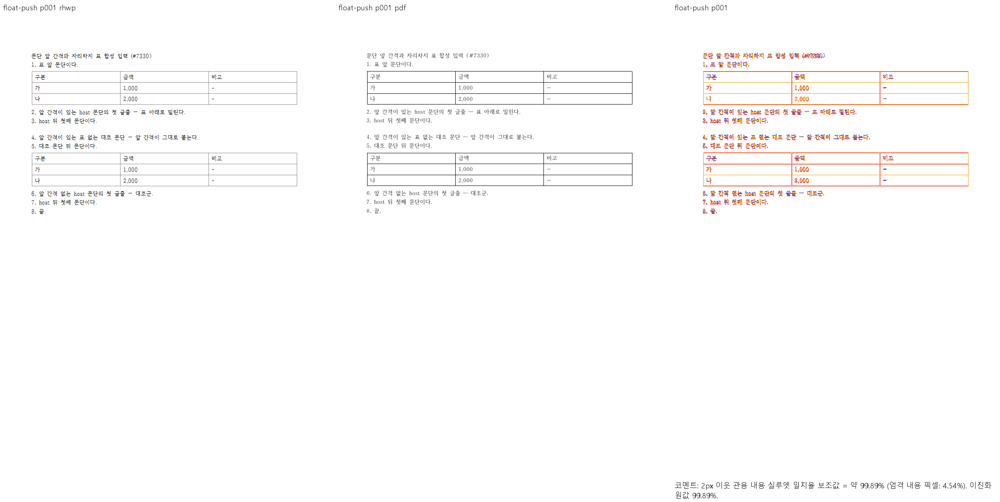
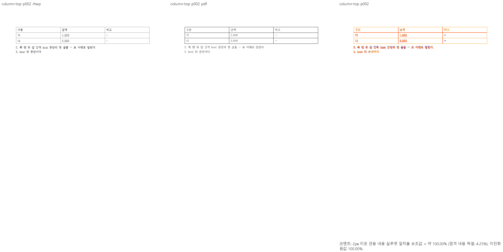

# PR #7617 리뷰 — 표가 민 첫 글줄의 문단 앞 간격

## 최종 판정

**머지 보류.** 공개 대조군의 충족, 실행으로 확인한 시각 미충족, 코드 검토상 우려와 필수 증거 부족을 아래에 구별한다. 사용자가 승인한 conflict·CI 보정은 진행했으나 90% 시각 gate는 면제되지 않는다. 통합 후보의 로컬 회귀 PASS를 원 contributor head의 독립 검증 완료나 merge 승인으로 보고하지 않는다.

## 접수·적용 범위

| 항목 | 값 |
| --- | --- |
| 원 PR·작성자·base | [#7617](https://github.com/edwardkim/rhwp/pull/7617) / planet6897 / devel |
| 원 head | `c19f5b805e4be92d9b51f561b2e47e0c587e3145` |
| 최초 적용 commit | `64f0a293212070210550021e64ecd5a1b7c5876c` |
| 이 PR의 적용 뒤 head | `3e7bacd2c9204d5bc3048b32628b8fc70a753bec`; 기능 commit 6개, 원 저자·cherry-pick -x 보존 |
| 누적 검증 source head | `90e2c6fd2c614ba0ea7667355c4ed2f3617f6563` |
| 최신 base 정렬 뒤 code head | `ae786f75b2cee72bd5576f6473bd51d9a8216f7c`; 제품/검증 입력 tree 동일 확인 |
| 검토 branch·reviewer | `review/planet6897-20261008` / jangster77; 원 PR reviewer assign 선행 |
| 원 PR 참고 상태 | draft=False, MERGEABLE / CLEAN; 작성 시점 snapshot이며 merge 직전 판정을 대신하지 않음 |
| 경로 | collaborator 외부 PR의 주 작업공간 누적 cherry-pick 9.1.1; intake/template/local_validation/visual_fixture_evidence 및 대형 PR 보조 절차 |

관련 이슈와 해결 표현은 원 PR 본문의 범위를 유지한다. 이번 보류 기록에 새로운 closes 표현을 추가하지 않는다. 원 PR 제공 before/after와 corpus 수치는 참고이며 통합 head의 독립 실행과 구별한다.

## 구현 주장·소비 경로·검증 판정

`typeset/paragraph.rs:223`의 float 표 원점과 `fmt.spacing_before` 차감 → `typeset/paragraph/metrics.rs:flow_trimmed_spacing_before / flow_advance_height` → `paragraph/flow.rs:place_fitted_paragraph`의 실제 배치를 대조했다. 표가 밀어낸 첫 글줄의 앞 간격 중복과 표 없는 정상 간격은 서로 다른 상태다.

공개 `float-push` 1쪽과 `column-top` 4쪽의 Native/fresh WASM 전쪽 최저는 각각 99.89324%, 99.09774%다. 대표 p1/p2에서 표 아래 첫 글줄·후속 문단 순서와 정상 대조군 간격을 직접 확인했다. **미검증:** 원 PR의 전체 영향 corpus에 있는 90% 미만 쪽, 대응 Print PDF가 없는 비공개 사례의 실제 저장본/재조판 경로. 공개 대조군의 충족만으로 원 PR 전체를 승인하지 않는다.

공통 빌드·회귀·글꼴 등록·383쪽 시각 결과와 입력/기준 해시·증적 보존·merge 후 댓글 계획은 [#7611 공통 통합 검증](pr_7611_review.md#공통-통합-검증과-증거-보존)에 연결한다. 이 PR의 조건부 수용이 아니라 미충족·미검증 해소 후 재검토 계획이다.

## 최신 보완의 경계 입력 검증

원 PR의 후속 구현 `7802047fb2682a2c97b35a3045dc76ddfac343fe`는 통합 후보에서 원 contributor 구현 뒤·메인터너 보정 앞의 `6230b09b6486e07cf3775580e9d9ff8f796f890d`로 반영했다. 아래 결과의 source head는 `59e1756d59b8d261b7d525772f991fe92e7edf9a`다. 최신 원 PR의 공개 경계 입력·기준 PDF·생성기·7개 회귀 source는 `1ed091daf421f92a9e2536645f9178877d54be40`의 정확한 Git blob을 ignored scratch로 추출해 선행 검증했으며, 아직 통합 commit에 추가하지 않았다.

공통 결과의 소비 경로는 `float_placement.rs:float_pushed_line_spacing_before` → `typeset.rs`의 첫 post-table 글줄 조건 → `state/commands.rs:consume_float_pushed_line_spacing`의 누적 높이·문단별 map → 단 전환의 map 전달 → `layout.rs`의 `start_line == 0` map 조회 → `paragraph_layout.rs:layout_partial_paragraph_with_spacing_before`의 확정 앞 간격이다. 저장 host 원점이 있는 경우는 생산 조건에서 제외한다. 앞 간격은 문단 상단 기준 거리이며, 표 점유 끝 위에 남는 몫만 한 번 예약한다. endnote 계측의 새 `EndnoteColumnPlacements`에도 global→local 문단 remap으로 map을 전달하는 호환 보정을 포함했다. 이 경계 입력은 endnote를 포함하지 않으므로 해당 endnote 실행 경계는 미검증이다.

공개 합성 HWPX(저장 줄 없는 생성본)와 이를 한/글 2020에서 저장한 HWP를 같은 HWP Print PDF 4쪽에 대조했다. Native/fresh WASM 각각 HWP 최저 99.43997%, HWPX 최저 96.45793%이며 총 16쪽 모두 `pr_review_gate=passed`, 누락·90% 미만은 0쪽이다. 16개 review PNG를 직접 열어 앞 간격이 표보다 큰/작은 host, 표 없는 대조 문단, 쪽 맨 위, 마지막 host 세 줄과 뒤 문단을 확인했다. 글꼴 획·농도와 HWPX 재조판의 일부 글자 간격 차이는 남으며 완전한 시각 일치로 보고하지 않는다.

독립 Print PDF의 텍스트에서 얻은 2쪽 채움 1~39·3쪽 채움 40~42를 네 출력의 실제 render tree와 대조해 순서·누락·중복 및 마지막 host 세 줄을 확인했다. 결과·입력/build hash·명령·manifest·PNG는 ignored `output/pr-review/planet6897-20261008/pr7617-boundaries-59e175/`의 `verification.json`·`page-ownership.json`과 네 하위 sweep에 보존한다. 이 검증은 공개 경계 입력의 신규 회귀 추가 선행 증거이며, 아직 실행하지 않은 해당 7개 정식 회귀의 PASS나 전체 영향 corpus·통합 PR 승인으로 기록하지 않는다.

## 편람 HWPX의 384쪽 불일치와 별도 메인터너 보정

후속 구현 `7802047` 적용 전 `1a1625ebdbbaf9369f142991fed0b4086f5db4d6`의 보존 WASM과 적용 후 `59e1756d59b8d261b7d525772f991fe92e7edf9a`의 보존 WASM을 같은 Chrome·원문·옵션으로 실행했다. 두 출력 모두 384쪽이고, 279~283쪽 SVG와 render tree 해시도 같았다. 따라서 이 마지막 구현이 해당 추가 쪽을 만들었다는 가설은 재현 결과와 맞지 않는다. 이 A/B는 이전 패키지를 사용한 원인 분리이며 최종 fresh WASM 승인 증거가 아니다. 기록은 `output/pr-review/planet6897-20261008/pr7617-source-ab-wasm/comparison.json`에 있다.

원본 HWPX 구역 10 문단 3의 제목 묶음 도형은 문단 기준·오프셋 0·자리차지이고, 빈 host의 유효 저장 줄은 폭 0, 높이 1000HU, 줄간격 600HU다. 도형 높이 6315HU와 아래 여백 1417HU의 합은 다음 목차 host의 저장 시작점 7732HU와 같다. 독립 Print PDF의 목차는 279~281쪽이며 뒤 질의·답변은 282쪽에서 시작한다. 도형은 보이지만 빈 host 줄은 도형 띠 안에 포함되므로 별도 공간으로 더하지 않는 계약이다.

기존 공통 판별 `renderer/mod.rs:empty_host_line_absorbed_by_topbottom_float` → `typeset/section/controls.rs`의 추가 예약 높이 → 가로 컬럼별 누적 예약과 `advance_flow_by` → `layout.rs:layout_shape_item`의 실제 도형 하단 전진을 추적했다. 그림 분기는 문단 측정에서 이미 소비한 host 줄을 차감했지만 도형 분기는 차감하지 않아 목차 예산에 1600HU(96dpi에서 21.33px)를 중복 계상했다. 도형 분기에도 같은 공통 판별을 적용했다. 문서 ID나 목차 항목 수로 분기하지 않으며, 글자·유효 줄 폭·세로 오프셋·구현 생성 줄 등 기존 판별의 반례 조건을 유지한다.

`59e1756d59` 위의 해당 source 수정 후보를 공유 `target/pr-review`에서 `cargo build --locked --jobs 8 --bin rhwp`로 새로 빌드했고 종료 코드 0을 확인했다. 같은 바이너리의 `dump-pages --compat 2024 --json`에서 HWPX 384→383쪽, HWP 대조군 383→383쪽이다. HWPX 목차 첫 예약 원점은 124.4→103.1px, 첫 두 조각의 끝 컷은 27/60→29/62로 바뀌어 원본 저장 줄의 쪽 경계와 일치한다. 마지막 조각 뒤 질의·답변도 283→282쪽이다. HWP는 전쪽 항목 소속이 같고 5쪽의 예약 높이만 변했다. 바이너리·source patch·원문 hash와 실행 로그는 `output/pr-review/planet6897-20261008/shape-host-absorption-v1/verification.json` 및 같은 디렉터리의 두 형식 페이지 계획·drift 로그에 보존했다.

첫 도형 보정 후보의 Native 279~283쪽 Visual Sweep 최저는 96.97055%, 자동 gate는 `passed`다. 5개 review PNG를 직접 열어 목차 항목 1~18/19~37/38~55의 소속과 뒤 본문 시작을 대조했고, render tree에서도 항목 1~55의 순서·누락·중복을 검사했다. 최초 실행은 Windows의 manifest 원자 교체 시 파일 접근 오류로 종료됐고, 동일 provenance의 `--resume` 실행 종료 코드 0을 확인했다. 원 실패 로그와 재개 로그를 모두 보존했다. **직접 판독으로 남은 배치 결함:** 명시적 우측 탭 쪽번호의 가로 이동과 281쪽 마지막 표 테두리의 부족한 높이. 높은 점수로 이 차이를 면제하지 않는다.

사용자가 지적한 281쪽 목차 쪽번호 18개의 시작은 Native x=596.27px, PDF advance box x=439.92pt(96dpi에서 586.56px)로 약 9.7px 오른쪽이다. 본문 `38.`/`39.`의 시작은 Native 120.5px, PDF 90.36pt(120.48px)로 맞는다. 원본 paraPr 742의 RIGHT 탭 정지는 38272HU이고, 단 시작에 더한 우단은 약 608.59px다. 기존 `find_next_tab_stop`이 이 정지를 생산했지만 교차 run 배치/폭 추정과 글자 위치 측정이 리더를 이유로 셀 콘텐츠 우단으로 덮어썼다. 후속 보정 후보는 명시적 탭 정지를 유지하고 자동 탭만 본문 우단을 생산하도록 생산자의 좌표계를 통일했다. `text_measurement.rs:find_next_tab_stop` → 문자 위치/폭 측정 → `paragraph_layout.rs:resolve_last_tab_pending` → 교차 run 폭 추정/방출의 실제 소비 경로를 함께 바꿨다. inline 저장 확장 탭의 별도 경로는 아직 이 보정의 검증 완료로 세지 않는다.

후속 탭 보정 후보도 `--jobs 8` Native 빌드 종료 코드 0과 HWP/HWPX 각각 383쪽을 확인했다. 새 281쪽 Native에서 쪽번호 시작점은 586.59px로 이동해 PDF 586.56px와 맞고, Visual Sweep 종료 코드 0·실루엣 99.12348%를 확인했다. 새 review PNG를 직접 열어 쪽번호·줄바꿈과 남은 표 아래 테두리 차이를 확인했다. 기록과 이미지는 `output/pr-review/planet6897-20261008/shape-host-and-right-tab-v2/`에 보존했다.

후속 탭 보정 후보의 fresh WASM 빌드와 실제 Chrome 281쪽 비교도 종료 코드 0을 확인했다. Native와 같은 쪽번호 위치·실루엣 99.12348%였고 새 review PNG를 직접 확인했다. 당시 표 아래 테두리 차이는 남아 있었으며 이 결과는 다음 종료 프레임 보정이나 전쪽 WASM 검증에 승계하지 않는다. 기록은 `shape-host-and-right-tab-v2/wasm-toc-panel/verification.json`에 보존했다.

종료 프레임 보정은 위 도형·탭 변경과 함께 `e469c4486e5e5d7b6de5a6e4a74d938e89dab188`에 커밋했다. 원본 단일 셀 선언 높이는 159642HU로 세 쪽을 포함하지만 기존 종료 helper는 첫 object 높이 47726HU 하나만 빼서 후속 빈 문단의 vpos와 비교했다. 실제 뒤 빈 문단의 저장 원점은 55458HU다. 새 `stored_single_cell_closing_frame_bottom`은 유효·비편집·비합성 저장 host/후속 줄을 확인하고 그 하단을 생산한다. 종료 `emit`은 실제 재개 컷이 원본 쪽 프레임에서 시작한 경우에만 현재 조각 원점을 빼고, 내용 요구 높이 이상·가용 예산 이하인지 확인한 같은 상자를 `partial_height`와 행 높이 override로 전달한다. 반복 머리행 높이는 override에서 한 번 제외한다. 내용 컷을 더 소비하거나 paint에서 별도로 상자를 늘리지 않는다. 편집·reflow·caption·각주·일반 셀 분기는 이 근거의 대용으로 쓰지 않는다.

이 커밋의 새 Native 279~282쪽 compare·standalone overlay·review를 산출했다(exit 0). 최저 98.49306%, 90% 미만·측정 불가 0쪽, focused gate `passed`다. 281쪽은 99.92654%이며 마지막 셀 높이는 709.3867→739.44px로 변했다. 네 review와 281쪽 standalone overlay를 직접 열어 쪽번호·표 아래 테두리·뒤 282쪽 본문을 대조했다. 실제 TextLine을 결합한 render tree 검사에서도 목차 1~18/19~37/38~55가 원래 279~281쪽에 한 번씩 순서대로 소속됐다. 글꼴 획·농도·AA, 제목 괘선 두께와 일부 본문 장식 경계는 남는다. source·binary·원본/PDF hash, 명령·PNG hash·직접 판독은 `committed-e469c4486-native-toc-provenance.json`, 소속은 `committed-e469c4486-toc-ownership.json`, PNG는 `committed-e469c4486-native-toc/handbook-hwpx-e469c4486/`에 보존한다. 이 자료는 Native 선택 쪽 증거이며 전쪽·fresh WASM·정식 새 회귀의 완료를 뜻하지 않는다.

**현재 미검증:** 종료 프레임 보정의 fresh WASM·전쪽 시각 검증·반례와 필수 lint 묶음. 전체 회귀는 [최신 커밋의 공통 결과](pr_7611_review.md#최신-커밋의-전체-회귀와-base-판정)처럼 28개가 실패했으며 최신 base의 90% 기준으로 이관/현재 보정을 구분 중이다. 첫 후보의 파생 suite를 준비한 review worktree의 `cargo fmt --all -- --check`와 fresh WASM 빌드는 통과했다. 주 작업공간에서 먼저 실행한 fmt 확인은 오래된 파생 목록의 누락 module 때문에 실패했으며 제품 결함 재현으로 세지 않는다. 후속 source 변경에는 첫 후보의 검증을 그대로 적용하지 않는다. 최신 원 PR head `85ea9a90bd0cd348b820db0eb9cea8d95356a15d`의 7개 경계 검사·자산은 선행 진단 scratch에만 있으며 아직 통합 commit에 추가하지 않았다.

## HWPX 전쪽 비교와 저장 경계 후보의 소유 보정

f971 제품 source의 HWP 편람 전383쪽은 Native/fresh WASM 최저90.08363%·누락0을 확인했다. 같은 source의 HWPX 전383쪽 Native는 최저27.09624%이며16쪽(116,126,135,140,152~156,223,287,289,290,370,373,375)이90% 미만이다. 같은 쪽수로 내용 소유의 차이를 면제하지 않는다.116/140/290쪽 compare·overlay·review를 직접 판독해 인접 표/뒤 본문 간격, 이어받기 문단 및 중첩 표의 실제 배치 차이를 확인했다. `candidate-f97144651-native-handbook-hwpx-full/provenance.json`과 `candidate-f97144651-hwpx-failure-panels/`에 보존하며, HWPX fresh WASM 전쪽 결과나 후속 코드의 통과로 승격하지 않는다.

140쪽의 원본(section3, host 문단64,1×1 RowBreak 셀)은 저장 줄이 문단16에서 새 원점으로 돌아간다. 독립 Print는 다음 문단17을140쪽에 두지만 Native는 그 문단들을 앞쪽으로 가져와140쪽을 문단20부터 시작한다. 실제 `CUT_BASE`는21유닛/714.507px, 기존 `stored_frame_cut_for_row`가 인증한 source 후보는16유닛/639.627px이며 동일 행 예산735.160px에 들어간다. `source_frame::resolve → source_tail → scan/runner/row_step`은 이 후보를 계산하고도 height extension이 양수가 아니라는 이유로 버렸다. 음의74.880px는 화면 위치를 맞출 보정 상수가 아니라 관측한 두 컷의 내용 높이 차이다. 원본과 소스 좌표, 진단 로그는 `pr7617-hwpx140-source-frame-closure.json`, `candidate-46de329e5-hwpx140-scan/`에 보존한다.

후속 후보는 기존 인증·profile·행 소유 gate 안에서, 실제 hard-break source 컷이 모든 셀의 capacity 컷보다 같거나 앞서며 적어도 하나가 앞설 때 그 source 컷을 선택한다. 해당 컷의 중첩 점유 예약까지 현재 행 예산에 들어가야 한다는 기존 판정은 유지한다. 예산이 source 경계에 못 미친 경우의 기존 양수 확장 계약·상한은 유지한다. 선택 결과는 같은 `res.end_cut/consumed_height`로 fit/retry와 emit을 거쳐 다음 continuation 시작 컷 및 실제 배치가 소비한다. source 인증을 완화하거나 임의로 컷 인덱스/좌표를 고정하지 않는다. 빈 물리 밴드·누적 예약과 최종 괘선/뒤 본문의 소비 경로도 새 실행에서 대조한다. 원본의 관련 출력 범위90%를 확보하기 전 새 회귀나 기준값을 추가하지 않는다.

제품 head `02de253c1bd84ca9607694694abfd7658a1bdb01`의 공유 target Native 빌드는 jobs8·exit0(452.17초)이다. 원본 결재문서5개 전7쪽은 최신 Native에서도 최저99.61781%다. 편람 HWPX의 기존 미달16쪽을 새로 출력한 결과,370쪽96.40865%와373쪽98.59779%는90% 이상이 됐으나 나머지14쪽은 미달이다. 전체 문서는383쪽이며 선택 쪽 비교를 전쪽 통과로 보고하지 않는다.140쪽은 문단17부터 이어받아 원본 소유 경계를 회복했지만26.89414%이고, 셀 안 문단 간격·그림·최종 외곽선의 높이 차이는 남는다. `candidate-02de253c1-handbook-boundaries.json`, `candidate-02de253c1-handbook-hwpx-boundaries/handbook-hwpx/silhouette.tsv`와 `candidate-02de253c1-handbook-boundary-panels/`에 실행·직접 비교 자료를 보존한다. fresh WASM 및 최종 전체 회귀는 아직 미검증이다.

116쪽 원본(section2,문단884/885)의 TAC 표 앞에는 흐름을 점유하지 않는 `IN_FRONT_OF_TEXT` 장식 도형이 있다. 두 host의 저장 높이7041HU는 표6761HU와 바깥여백140+140HU의 합이고, 다음 저장 원점12921−4440=8481HU에는 첫 줄 후행 간격1440HU도 포함된다. 기존 Native의 표 원점 차이는93.9px로 줄 높이만 소비하고19.2px의 간격을 놓쳤다. 장식이 없다는 단일 컨트롤 가정 때문에 `stored_tac::prepare_computed`가 닫힌 원본 저장 줄을 거절하고, 일반 paint의 가시 장식 전용 억제 경로가 후행 간격을 버린 것이 원인이다. 장식은 비가시 metadata가 아니며, 가시성과 흐름 점유를 구별한다.

후속 후보는 편집되지 않은 HWPX의 기존 저장 원점·후속 줄 연결·실측 높이 인증을 유지하면서, 유일한 표와 비TAC 글 앞/뒤 장식만 있는 경우 실제 표 컨트롤 번호로 계획을 만든다. 합성 줄은 기존 단일 컨트롤 조건을 유지하고, 자리차지·어울림·TAC 장식과 다른 표는 이 단축을 쓰지 않는다. 생산 `prepare_computed`의 `origin/end` → `commit_stored_tac_control`의 fit/흐름/inline placement → `layout_table_control`의 같은 pen와 `advance_end` 소비를 연결한다. 장식은 기존 `place_paragraph_controls`에서 계속 발행한다. 새 후보의 직접 출력과 원본 대조군은 아직 미검증이며, 이 단계에 새 시험·fixture·golden을 추가하지 않는다.

140쪽에서 남은 간격 차이는 빈 문단16/18/22의 실제 저장 슬롯1760/1872/1700HU(합71.09333px)와 연결된다. 모두 다음 저장 줄 원점에 정확히 닿지만 현재 tree에는 세 문단의 줄이 없고, 문단17이 셀 위 패딩 직후 시작한다. `cell_units_uncached::preserve_forward_stored_empty_spacer`는 직접 HWPX에 선언 높이800px 이상과 셀 전체의 선형 등식을 요구한다. 해당 표는735.70667px이고 그림 host11/14 뒤에는 바깥 간격300HU가 있어 두 전제를 통과하지 못한다. 반면 분할 컷은 이미 `direct_hwpx_cell_has_declared_stored_frame`으로 같은 원본의 두 프레임을 인증한다. 독립 PDF 텍스트 연산자·원본 저장 줄·현재 tree/hash는 `candidate-02de253c1-book140-blank-trace.json`에 보존한다.

`ca98ce5e8b15d50886fca35a99bd24580eeaf8ab`의 Native 빌드429.72초·exit0, 결재문서5개 전7쪽 최저99.61781%, 기존 의미 검사2PASS를 확인했다. 의미 검사는 검증한 기존 harness와 변하지 않은 모델·parser·검사 source를 재사용하되 출력 CLI를 새 바이너리로 고정했으며 최종 전체 suite 컴파일로 보고하지 않는다.116쪽은39.39997→97.35333%이고 표 원점·뒤 본문 간격이 맞지만, 직접 review에서 화살표 장식의 누락을 검출했다. 앞 기록의 `place_paragraph_controls`가 장식을 발행한다는 설명은 잘못됐다. 표 host의 장식은 일반 `controls/paragraph_flow::place_table_host_shape`가 발행하며, 저장 줄 단축의 조기 반환이 그 경로를 건너뛰었다. 높은 보조값으로 이 누락을 면제하지 않는다. 실행 기록은 `candidate-ca98ce5e8-native-check.json`, `candidate-ca98ce5e8-approval-existing-harness.json`, `candidate-ca98ce5e8-handbook-boundaries.json`과 같은 head의 대표 패널에 있다.

다음 후보는 확정된 단일 저장 TAC 표 앞뒤의 흐름 비점유 장식을 원래 컨트롤 순서대로 같은 `place_table_host_shape`에서 발행한다. 별도 줄 예약을 추가하지 않고 표 계획의 pen을 host 앵커로 전달한다.140쪽의 빈 줄은 기존 source frame 인증과 편집·dirty 제외를 공유하고, 빈 줄의 저장 높이·후행 간격·다음 원점이 정확히 닫힐 때만 물리 전진량을 보존한다. 측정은 그 값을 같은 `CellUnit`에 기록하고 실제 부분 표 배치는 현재 컷이 소유한 그 유닛의 높이를 소비한다. 글자가 없는 compositor 결과를 공간이 없다는 뜻으로 쓰지 않으며, 다른 조각의 빈 줄은 현재 쪽에 다시 소비하지 않는다. 일반 합성·로컬 리셋·중첩 표의 기존 계약은 유지한다. 새 후보의 전체 쪽수·빈 줄 앞뒤 내용·장식·외곽선·정상 대조군 및 Native/fresh WASM은 아직 미검증이며, 새 회귀나 기준값을 추가하지 않는다.
