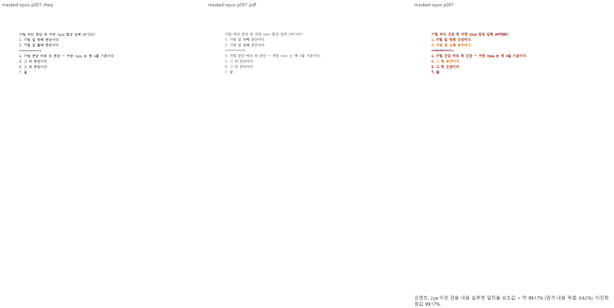

# PR #7618 리뷰 — 가림 뒤 낡은 저장 vpos

## 최종 판정

원격 상태 재확인: #7618은 2026-10-08 병합 없이 **CLOSED**이며, 메인테이너 대체 [PR #7667](https://github.com/edwardkim/rhwp/pull/7667)에서 후속 CI·병합을 진행한다. #7667은 확인 시 OPEN이다. 아래는 이 누적 브랜치에서 기존 head를 검토한 이력이며, #7667의 source·검증을 재검토하거나 완료 판정한 기록이 아니다. 이미 병합된 #7619와 달리 #7618의 구현은 현재 base에 병합된 것으로 간주하지 않는다.

**머지 보류.** 공개 대조군의 충족, 실행으로 확인한 시각 미충족, 코드 검토상 우려와 필수 증거 부족을 아래에 구별한다. 사용자가 승인한 conflict·CI 보정은 진행했으나 90% 시각 gate는 면제되지 않는다. 통합 후보의 로컬 회귀 PASS를 원 contributor head의 독립 검증 완료나 merge 승인으로 보고하지 않는다.

## 접수·적용 범위

| 항목 | 값 |
| --- | --- |
| 원 PR·작성자·base | [#7618](https://github.com/edwardkim/rhwp/pull/7618) / planet6897 / devel |
| 원 head | `3febe51043d7e96af520b9acb99793c6e97bb394` |
| 최초 적용 commit | `bc0fa6af30b0942df58bc3f5919a7af4d07d9d9e` |
| 이 PR의 적용 뒤 head | `f737022935e76bf46f6b17c48231288a53650b2a`; 기능 commit 4개, 원 저자·cherry-pick -x 보존 |
| 누적 검증 source head | `90e2c6fd2c614ba0ea7667355c4ed2f3617f6563` |
| 최신 base 정렬 뒤 code head | `ae786f75b2cee72bd5576f6473bd51d9a8216f7c`; 제품/검증 입력 tree 동일 확인 |
| 검토 branch·reviewer | `review/planet6897-20261008` / jangster77; 원 PR reviewer assign 선행 |
| 원 PR 참고 상태 | draft=False, MERGEABLE / CLEAN; 작성 시점 snapshot이며 merge 직전 판정을 대신하지 않음 |
| 경로 | collaborator 외부 PR의 주 작업공간 누적 cherry-pick 9.1.1; intake/template/local_validation/visual_fixture_evidence 및 대형 PR 보조 절차 |

관련 이슈와 해결 표현은 원 PR 본문의 범위를 유지한다. 이번 보류 기록에 새로운 closes 표현을 추가하지 않는다. 원 PR 제공 before/after와 corpus 수치는 참고이며 통합 head의 독립 실행과 구별한다.

## 구현 주장·소비 경로·검증 판정

`height_cursor.rs:244`의 저장 HWPX 전방 보정과 `source_line_seg_vertical_pos` 기반 연속성 판정 → `vpos_corrected_end_y` → 실제 문단 원점을 대조했다. 편집/dirty 여부, 가림으로 사라진 저장 줄과 유효한 일반 저장 갭을 구별해야 하며 줄이 안 보인다는 사실은 점유 높이 부재의 증거가 아니다.

공개 `masked-vpos` 1쪽 Native/fresh WASM 최저 99.16989%. 별표 가림 줄 뒤 4번 문단과 뒤 세 문단의 위치·순서를 직접 확인했다. **미검증:** 비공개 원문과 독립 Print PDF의 전후 비교 및 원 PR의 전체 영향 corpus. 실물 저장본과 합성 가림 입력의 증거를 혼동하지 않는다.

공통 빌드·회귀·글꼴 등록·383쪽 시각 결과와 입력/기준 해시·증적 보존·merge 후 댓글 계획은 [#7611 공통 통합 검증](pr_7611_review.md#공통-통합-검증과-증거-보존)에 연결한다. 이 PR의 조건부 수용이 아니라 미충족·미검증 해소 후 재검토 계획이다.

