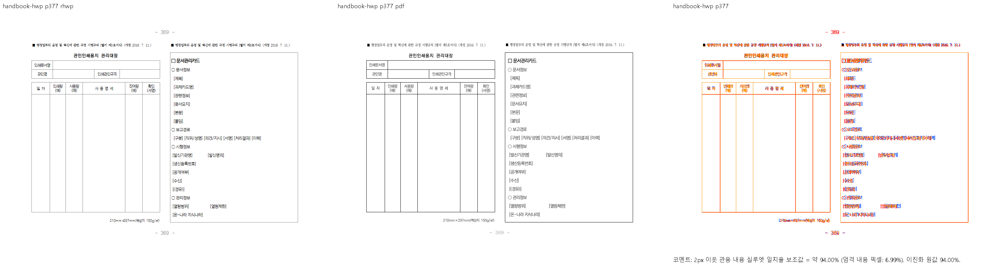

# PR #7624 리뷰 — KoPub useFontSpace 공백 폭

## 최종 판정

**머지 보류.** 공개 대조군의 충족, 실행으로 확인한 시각 미충족, 코드 검토상 우려와 필수 증거 부족을 아래에 구별한다. 사용자가 승인한 conflict·CI 보정은 진행했으나 90% 시각 gate는 면제되지 않는다. 통합 후보의 로컬 회귀 PASS를 원 contributor head의 독립 검증 완료나 merge 승인으로 보고하지 않는다.

## 접수·적용 범위

| 항목 | 값 |
| --- | --- |
| 원 PR·작성자·base | [#7624](https://github.com/edwardkim/rhwp/pull/7624) / planet6897 / devel |
| 원 head | `b09251980913178c48f3b2c02b2c62cd8637f6c1` |
| 최초 적용 commit | `fb9a257b99be272f23e3e9b8f8e1cc4acab6cdc9` |
| 이 PR의 적용 뒤 head | `2fa4a4d702836922d92add2fc7d7a5caf27a8a56`; 기능 commit 3개, 원 저자·cherry-pick -x 보존 |
| 누적 검증 source head | `90e2c6fd2c614ba0ea7667355c4ed2f3617f6563` |
| 최신 base 정렬 뒤 code head | `ae786f75b2cee72bd5576f6473bd51d9a8216f7c`; 제품/검증 입력 tree 동일 확인 |
| 검토 branch·reviewer | `review/planet6897-20261008` / jangster77; 원 PR reviewer assign 선행 |
| 원 PR 참고 상태 | draft=False, MERGEABLE / CLEAN; 작성 시점 snapshot이며 merge 직전 판정을 대신하지 않음 |
| 경로 | collaborator 외부 PR의 주 작업공간 누적 cherry-pick 9.1.1; intake/template/local_validation/visual_fixture_evidence 및 대형 PR 보조 절차 |

관련 이슈와 해결 표현은 원 PR 본문의 범위를 유지한다. 이번 보류 기록에 새로운 closes 표현을 추가하지 않는다. 원 PR 제공 before/after와 corpus 수치는 참고이며 통합 head의 독립 실행과 구별한다.

## 구현 주장·소비 경로·검증 판정

`style_resolver.rs:637`의 `declared_space_advance_em` → 영문 슬롯 `use_font_space` 해소 → `layout::kopub_declared_space_em`과 폭 측정 소비를 대조했다. 설치한 실제 legacy TTF hmtx에서 돋움 공백 0.290em, 바탕 0.312em을 독립 조회했고 6 face × ASCII 95자 = 570개 폭이 기존 전용 표와 모두 일치했다. KoPub World를 같은 face로 등록하거나 이름을 바꾸지 않았다.

편람 HWP 377/378쪽은 Native/fresh WASM 94.00029%/99.47783%. 양식 괘선·시작점과 줄바꿈을 직접 비교했고 377쪽 일부 입력 칸·문자 여백 차이는 보존한다. 전체 편람에서 50쪽 gate 실패가 있어 부분 점수를 전체 일치로 보고하지 않는다.

domestic violence의 기존 40쪽 PDF는 Hwp 2018/비KoPub face, 새 커밋된 KoPub Print PDF는 Hwp 2020/39쪽이다. 현재 Native 39쪽은 새 기준의 쪽수와 일치하지만, 출처·글꼴 환경이 다른 PDF를 임의 baseline 교체로 취급하지 않고 구별한다. **미검증:** 이 문서 전쪽 시각 비교와 HWPX 전쪽, 변경 폭이 영향을 주는 모든 pagination/paint 소비 경계.

공통 빌드·회귀·글꼴 등록·383쪽 시각 결과와 입력/기준 해시·증적 보존·merge 후 댓글 계획은 [#7611 공통 통합 검증](pr_7611_review.md#공통-통합-검증과-증거-보존)에 연결한다. 이 PR의 조건부 수용이 아니라 미충족·미검증 해소 후 재검토 계획이다.

